# 糾正筆記 fixnote

把「糾正 AI」變成「寫死的規定」。發現 AI 做錯時填一句話，Claude 會補上原因、預防方法，以及一條白話的規定。能用程式碼判斷的錯會直接**上鎖**：之後 Claude 在任何專案寫出同樣的程式碼，都會在寫檔前被當場擋下。

<p>
  
  
</p>

面板最上方的任務顯示幕（會動）。左：一切正常；右：新規定正在上鎖、有一項驗證失敗。

## 安裝

在 Claude Code 終端機的輸入框打：

```
/plugin install fixnote --marketplace lee851104/Val
```

問要不要加入 marketplace 時按 `y`，再選安裝範圍（建議選「使用者」，所有專案都能用）。

從命令列安裝：

```
claude plugin install fixnote --marketplace lee851104/Val
```

在桌面版（`/plugin` 不能用時）：按輸入框旁的 +，選 Plugins，用 Add marketplace 加入 `lee851104/Val`，再按 Add plugin。

需要支援 mods 的 Claude Code 版本。

## 面板

任務控制台風格。

- 任務顯示幕（桌面版、VS Code、手機）：深空背景和地平線，每條生效的防線是一顆繞軌道的衛星；大字顯示防線數、擋下次數、驗證通過數；右上角狀態燈（NOMINAL／FAULT／STANDBY）；底部 9 格 PRE-FLIGHT 驗證燈。終端機改用文字儀表。
- LOG ENTRY：「AI 做錯了什麼？」，打一句話按 Enter。
- LATEST：最新一筆寫死的規定和防護強度。新規定上鎖時會跑 ARMING 動畫，並自動展開示範。
- GUARDS：點一下展開，看「錯的擋下、對的放行」的示範，也能暫停（HOLD）或恢復。
- PRE-FLIGHT CHECKS：按「RUN 跑一次」，逐項顯示 GO／FAULT；還沒設定的按「ADD 加上」。
- DEBRIEF：請 Claude 整理重複犯的錯。

Claude 被擋下時，輸入框上方會出現 `● INTERCEPTED` 提示。輸入 `/fixnote-panel` 可以重新打開面板。

## 驗證

面板固定列出 9 種預設驗證：lint 規則、靜態分析、單元測試、功能測試、回歸測試、驗收測試、冒煙測試、畫面測試、變異測試。

- 已設定的：按「跑一次」後顯示 ✓／✕ 和一句結果。
- 還沒設定的：顯示一句白話說明和「加上」，按下去請 Claude 幫專案補上，並寫進設定檔。
- 靜態分析一定會跑「防線掃描」：拿已上鎖的規定掃專案現有的程式碼（略過 node_modules、建置產物和測試檔）。

每種驗證的指令從哪裡來：先看 `.fixnote/checks.json`，沒寫的再從 `package.json` 的 scripts 自動偵測（例如 `lint`、`typecheck`、`test`、`test:e2e`、`build`）。

```json
{
  "scan": "要掃描的資料夾（不寫就是目前專案）",
  "checks": {
    "unit": { "run": ["npm", "run", "test"], "match": "【單元】" },
    "smoke": { "run": ["npm", "run", "build"], "cwd": "選填，執行的資料夾" }
  }
}
```

每項驗證預設最多跑 3 分鐘，超過會顯示「超過 3 分鐘沒跑完」。跑比較久的（例如變異測試）可以加 `"timeoutMs": 600000`（10 分鐘）。

`match` 讓好幾種驗證共用同一個測試指令：測試名稱以【單元】、【功能】、【回歸】、【驗收】、【畫面】開頭，就會分別算到對應的那一列。同一個指令只會跑一次。

## 內容

- 面板和當場擋下：`hooks/register.tsx`
- 任務顯示幕的圖：`hooks/mission.ts`
- 分析錯誤、寫筆記的 skill：`skills/fixnote/SKILL.md`，裝好就有，也可以輸入 `/fixnote 一句話` 直接記一筆。
- 筆記本存在每個人自己電腦的 `~/.claude/fixnote/糾正筆記.md`，不會上傳。

## 限制

只擋得住 Claude Code 裡 AI 的 Write 和 Edit，擋不住手打的程式或其他工具。同類錯出現 3 次以上時，仍建議在專案加上 lint 規則或測試。
